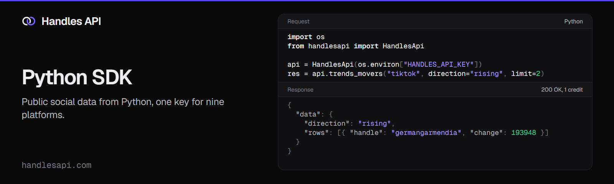
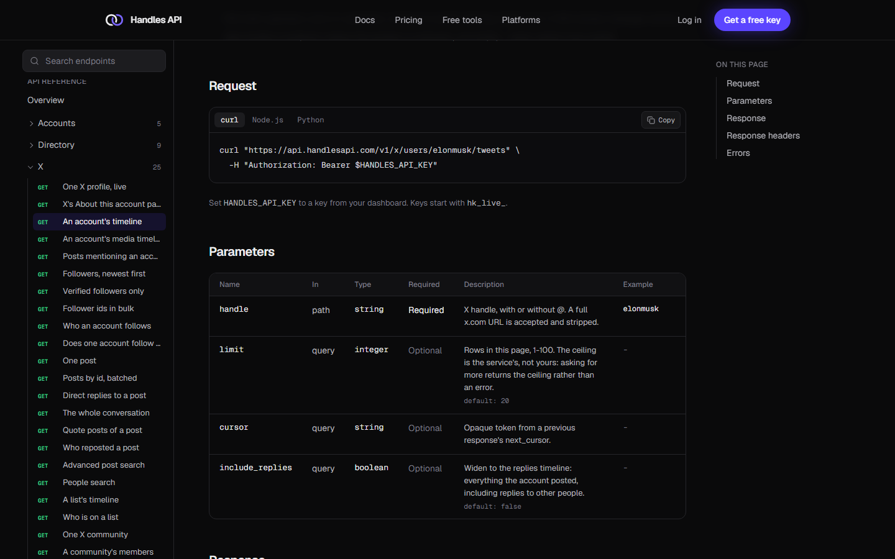

# handlesapi-python

`handlesapi-python` is the Python client for [Handles API](https://handlesapi.com), a REST and MCP API that returns public data from X (Twitter), Instagram, TikTok, YouTube, Telegram, Bluesky, Twitch, Kick and LinkedIn companies in one consistent JSON shape. It wraps all 113 endpoints from the [OpenAPI spec](https://github.com/handlesapi/openapi) in typed methods, with a sync client and an async client, both built on `httpx`. Responses are typed with `TypedDict`, and the package ships `py.typed` (checked with `mypy --strict`).

## Why

- Sync and async clients on `httpx`, with `py.typed` and `mypy --strict` clean types, so editors and type checkers know every field.
- Every one of the 113 endpoints is a method, generated from the OpenAPI spec by the generator in this repo, so the client and the API cannot drift silently.
- The things you would otherwise write yourself are built in: `X-Credits-*` parsing, `Retry-After` handling, backoff for transient failures, cursor pagination and typed errors.

## Quickstart

### Install

The package is not published to PyPI yet. Install it straight from GitHub:

```bash
pip install "git+https://github.com/handlesapi/handlesapi-python.git"
```

Requires Python 3.9 or newer. The only dependency is `httpx`.

### First call

Get an API key at [handlesapi.com/signup](https://handlesapi.com/signup). The Free plan gives you 100 credits to try every endpoint, once, with no card. Keep the key on the server: it spends your credits.

```python
import os
from handlesapi import HandlesApi

with HandlesApi(os.environ["HANDLES_API_KEY"]) as api:
    # Catalog check: 1 credit.
    res = api.accounts_check("youtube", "mrbeast")
    print(res.data["identity"]["name"], res.data["audience"]["count"], res.data["audience"]["metric"])
    print("credits left:", res.credits.remaining)

    # Live read of an X timeline: 2 credits.
    tweets = api.x_users_tweets("nasa", limit=5)
    for t in tweets.data["tweets"]:
        print(t["likes"], t["text"])
```

If you omit the key, the client reads `HANDLES_API_KEY` from the environment. An async twin, `AsyncHandlesApi`, has the same methods:

```python
import asyncio
from handlesapi import AsyncHandlesApi

async def main() -> None:
    async with AsyncHandlesApi() as api:
        res = await api.directory_search(q="nasa", limit=3)
        print(res.data["query"], res.request_id)

asyncio.run(main())
```

## Endpoints



Every endpoint has a method named after its `operationId` in snake_case. Path, query and body parameters are plain arguments (required ones first, the rest keyword-only), and `data` is a `TypedDict`.

| Endpoint | Method |
| --- | --- |
| `GET /accounts/{platform}/{handle}` | `api.accounts_check(platform, handle)` |
| `POST /accounts/check` | `api.accounts_bulk(targets=[...])` |
| `GET /directory/search` | `api.directory_search(q=...)` |
| `GET /x/users/{handle}/tweets` | `api.x_users_tweets(handle, limit=...)` |
| `GET /insights/instagram/{handle}/top-posts` | `api.insights_instagram_top_posts(handle)` |
| `GET /trends/{platform}/movers` | `api.trends_movers(platform)` |
| `GET /leads/linkedin/companies` | `api.leads_linkedin_companies_list(country=...)` |

The full list, with credit costs, is `handlesapi.OPERATIONS` and the [API reference](https://handlesapi.com/docs/reference). `api.request("GET", "/accounts/platforms")` reaches any path directly.

## Pricing and credits

Catalog, insights, identity and lead reads cost 1 credit; live reads cost 2. Plans: Free (100 credits, once, no card), Starter ($29 a month, 15,000 credits), Pro ($99, 75,000), Business ($299, 300,000), Scale ($799, 1,200,000). See [Credits and limits](https://handlesapi.com/docs/credits-and-limits) and [pricing](https://handlesapi.com/pricing).

### Credits and rate limits in code

Every `Response` carries the parsed headers:

```python
res = api.accounts_platforms()
res.credits      # Credits(cost=1, remaining=1199983, period_end="...")   from X-Credits-*
res.rate_limit   # RateLimit(limit, remaining, reset)                     from X-RateLimit-*
res.request_id   # quote it to support
```

Catalog, insights, identity and lead reads cost 1 credit; live reads cost 2. See [Credits and limits](https://handlesapi.com/docs/credits-and-limits) and [pricing](https://handlesapi.com/pricing).

## Errors and retries

Every failure raises `HandlesApiError` with the stable `code`, the HTTP `status`, `request_id` and, for `invalid_request`, per-field `details`. Branch on `code`, never on the message. Failures that never reach the API raise `HandlesApiConnectionError`.

```python
from handlesapi import HandlesApi, HandlesApiError

try:
    api.accounts_check("x", "nasa")
except HandlesApiError as err:
    if err.code == "quota_exceeded":
        print("Out of credits: upgrade or enable overage")
    else:
        print(err.code, err.status, err.request_id, err.details)
```

The client retries what the [error table](https://handlesapi.com/docs/errors) marks as retryable: `rate_limited` and `live_limit_reached` (it waits for `Retry-After`, up to 30 seconds, otherwise it raises), and `platform_unavailable`, `upstream_timeout`, `upstream_error`, `service_unavailable`, `internal_error` plus network failures (exponential backoff with jitter, 0.5 s to 8 s). It never retries `quota_exceeded`, `invalid_request`, `unauthorized` or `not_found`.

| Argument | Default | Meaning |
| --- | --- | --- |
| `api_key` | `HANDLES_API_KEY` | API key |
| `base_url` | `https://api.handlesapi.com/v1` | API base URL |
| `max_retries` | `2` | Retries per call (0 disables) |
| `timeout` | `60.0` | Per-attempt timeout in seconds; every method also takes `timeout=` |
| `max_retry_after` | `30.0` | Longest `Retry-After` it will sleep through |
| `http_client` | new `httpx.Client` | Bring your own client (proxies, transports) |

## Pagination

List endpoints return `meta.page.next_cursor`. `paginate` follows it and yields one `Response` per page until the cursor is `None`:

```python
for page in api.paginate(api.x_users_tweets, handle="nasa", limit=100, max_pages=3):
    print(len(page.data["tweets"]), page.credits.remaining)
```

Each page costs credits, so set `max_pages`. With `AsyncHandlesApi`, use `async for`. See [Pagination](https://handlesapi.com/docs/pagination).

## Regenerating from the spec

The types and method list under `src/handlesapi/` (`_types.py`, `_operations.py`, `_methods.py`) are generated from [`openapi.json`](https://github.com/handlesapi/openapi). The generator is part of this repo and uses only the standard library:

```bash
python scripts/generate.py                    # downloads the latest spec from handlesapi.com/openapi.json
python scripts/generate.py ./openapi.json     # or use a local copy
```

## Development

```bash
pip install -e ".[dev]"
mypy        # strict type check
pytest      # tests run against a mocked transport
```

## MCP

The same API is available to AI assistants as a remote [Model Context Protocol](https://modelcontextprotocol.io) server at `https://api.handlesapi.com/mcp`, with 23 tools that spend the same credits. Setup for Claude, Cursor, VS Code and Claude Code is in [handlesapi/mcp](https://github.com/handlesapi/mcp); the tool list is in the [MCP docs](https://handlesapi.com/docs/mcp).

## Links

- Website: [handlesapi.com](https://handlesapi.com)
- Documentation: [handlesapi.com/docs](https://handlesapi.com/docs)
- API reference: [handlesapi.com/docs/reference](https://handlesapi.com/docs/reference)
- Authentication: [handlesapi.com/docs/authentication](https://handlesapi.com/docs/authentication)
- MCP server for AI assistants: [handlesapi.com/docs/mcp](https://handlesapi.com/docs/mcp)
- Pricing: [handlesapi.com/pricing](https://handlesapi.com/pricing)
- Examples: [handlesapi/examples](https://github.com/handlesapi/examples)
- MCP server: [handlesapi/mcp](https://github.com/handlesapi/mcp)
- Changelog: [CHANGELOG.md](CHANGELOG.md), contributing: [CONTRIBUTING.md](CONTRIBUTING.md), security: [SECURITY.md](SECURITY.md)
- TypeScript client: [handlesapi-js](https://github.com/handlesapi/handlesapi-js)
- OpenAPI spec: [handlesapi.com/openapi.json](https://handlesapi.com/openapi.json), also in [handlesapi/openapi](https://github.com/handlesapi/openapi)

Handles API is an independent service and is not affiliated with any of the platforms it covers. It returns public data only. MIT licensed.
